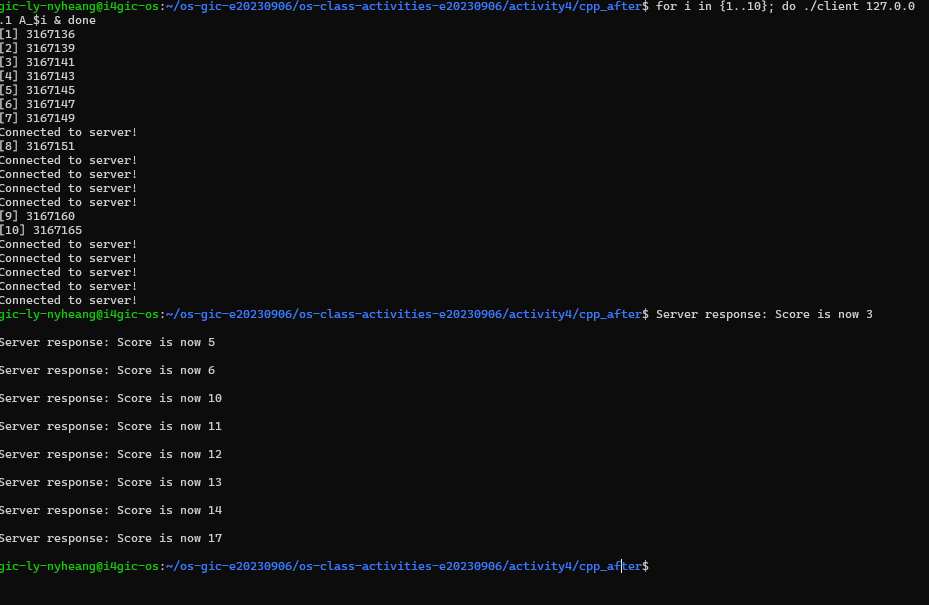
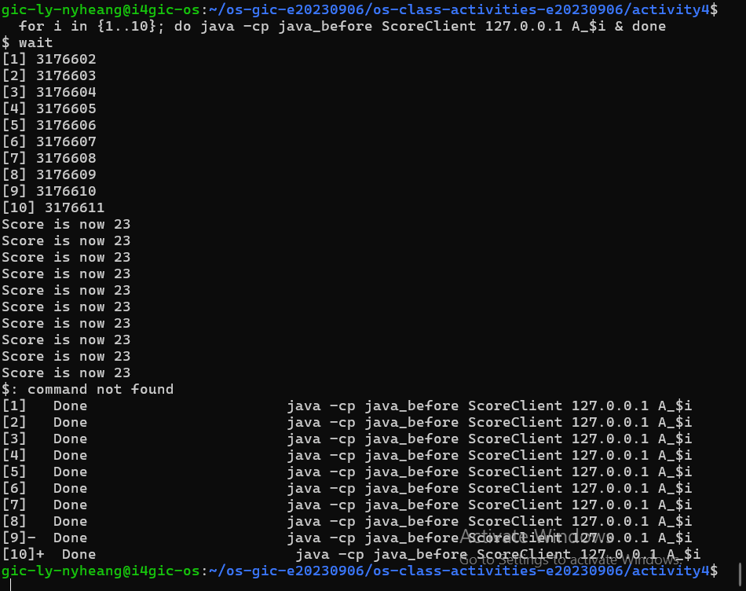
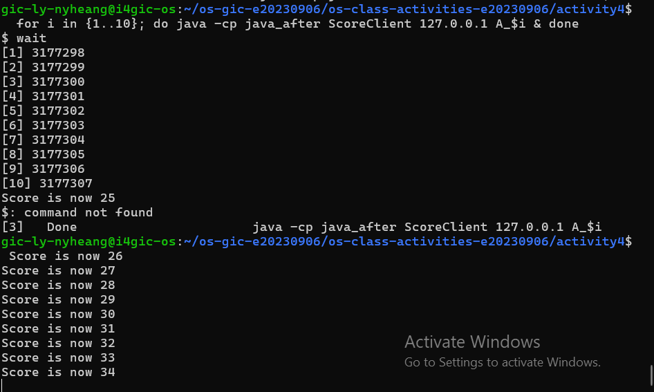

# Class Activity 4 — Shared File API

- Student Name: Borin Powiney
- Student ID: e20231335
- Partner Name: Ly Nyheang
- Partner Student ID: e20230906
- Server Machine Owner: Ly Nyheang
- Server IP Address: 172.0.0.1

---

## Task 1: C++ Before Mutex

- Expected score after 20 total client requests: 20
- Actual score: 1
- What happened: Because the code is in cpp_before (before synchronization/locking was added) and all ./client processes ran concurrently in the background (&), multiple requests read the same initial score (0) at the same time, added 1 to get 1, and overwrote each other's updates (race condition / lost updates). As a result, all increments collapsed into a single update of 1 instead of accumulating cleanly.

---

## Task 2: C++ After Mutex
 

- Expected score after 20 total client requests: 20
- Actual score: 20
- What changed after adding mutex: Adding a mutex serializes access to the critical section (reading, incrementing, and updating the shared score) so only one thread/request updates it at a time. Instead of concurrent requests overwriting each other and collapsing to 1 (as in cpp_before), updates no longer get lost and the score properly progresses up to 20. (Notice also that the score jumps by more than 1 between some lines—such as 2 to 4 or 9 to 15—because multiple requests were processed across the run and output lines appeared asynchronously while the shell prompt returned early.)

---

## Task 3: Java Before Synchronized

- Expected score after 20 total client requests: 20
- Actual score: 24
- What happened: Because the code is in java_before (without synchronized protection) and 10 clients ran concurrently in the background (&), multiple requests read the same score (23) simultaneously, incremented it to 24, and overwrote each other's work (race condition / lost updates). Eight responses repeated Score is now 23 and only one reached Score is now 24 instead of advancing cleanly for every increment.

---

## Task 4: Java After Synchronized

- Expected score after 20 total client requests: 
- Actual score: 44
- What changed after adding synchronized: Adding synchronized enforces mutual exclusion on the critical section so only one thread updates the score at a time. Instead of duplicate scores and lost updates from race conditions (as seen in java_before), each of the 10 concurrent client requests cleanly increments the score one by one (35, 36, 37, 38, 39, 40, 41, 42, 43, 44).

---

## Questions

1. Why should clients send requests to the server instead of writing the file directly?
 >Centralizing updates prevents uncontrolled file access. The server becomes the authority for the shared resource and can enforce synchronization consistently.

2. Why does the server still have a race condition before mutex or synchronized?
>It creates one thread per client. Different threads can read, modify, and write the file concurrently. The read–modify–write sequence is not atomic.

3. In the C++ fixed version, what does std::lock_guard<std::mutex> protect?
>It protects the complete file-update operation in update_score(): reading the file, calculating the new value, sleeping, and writing the file.

4. In the Java fixed version, what does synchronized protect?
>It protects the entire updateScore() method. For a static method, the lock belongs to the class. Only one thread may execute that method at a time.

5. Why is the final score expected to be 20 when Student A sends 10 requests and Student B sends 10 requests?
>Each student sends 10 successful requests: 10 Student A requests + 10 Student B requests = 20 increments

6. What could happen if two separate servers update the same file at the same time?
>They would need separate synchronization with each other. Two independent servers can still race because one server’s mutex or Java monitor does not protect threads running in the other server process. The result could be lost or corrupted updates.
---

## Reflection

This activity demonstrated the difference between C++ std::mutex and Java synchronized, while showing that both provide mutual exclusion for a shared resource. C++ required a mutex and std::lock_guard to protect the complete read–delay–increment–write operation. Java used a synchronized instance method to ensure that only one thread could execute updateScore at a time.

The tests showed that sharing a file introduces a race condition even when all requests are handled through one server. A thread could read the same score, be delayed, and then write an overwritten value. Although the unsafe versions did not always lose updates, the synchronization prevented this issue consistently.

This activity taught me that synchronization must protect the entire critical section, not just the file write. Without a server, concurrent clients could update the file directly. With a server, the file is controlled centrally, but every client still creates a separate server thread that may access the file simultaneously. Both C++ and Java solutions ensured that updates occurred in a correct, one-at-a-time order.

Overall, I learned that synchronization is necessary whenever multiple threads share data or resources. Even small operations such as reading and incrementing a score can cause incorrect results if they are not protected as a complete critical section.